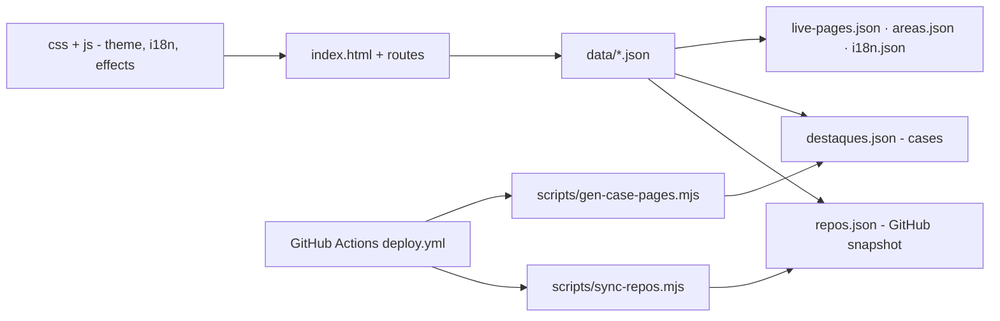

# portfolio-kelvin-v2

**English** · [Português (Brasil)](README.md)

[](#) [](#) [](#) [](#) [](#)

A multi-page portfolio for **Kelvin Oliveira** — pure HTML/CSS/JS, no build, in Portuguese and English.

## What it is

A portfolio site presenting Kelvin Oliveira's projects, numbers and skills. It is a multilingual static site (PT/EN) that consumes JSON data, navigates through routes and publishes to GitHub Pages via GitHub Actions.

## Status

In production (v2). Published at <https://kelvinoliveiracode.github.io/portfolio/> (HTTP 200 verified). Automatic deploy via GitHub Actions.

## Features

- **6 pages**: Home, Projects (full archive), case studies (`/projetos/<slug>/`), About, Certificates and 404.
- **GitHub tree explorer** on the home page, with numbers traced to a source.
- **Area filter and search** on the projects page.
- **11 case studies** generated by `scripts/gen-case-pages.mjs`.
- **4 DIO certificates** with verification links.
- **PT/EN i18n** (`data/i18n.json`).
- **Visual direction**: black and white with no chromatic accent, a dotted Earth planet (2D canvas) in the hero, optional motion respecting `prefers-reduced-motion`, and a minimum 4.5:1 text contrast.

## Architecture

A static site made of `index.html` + modular CSS (`tokens.css`, `site.css`, `paginas.css`) + per-page JS (home, effects, i18n, tree, et al.). Data comes from `data/*.json`; a deploy pipeline syncs the repositories and regenerates the case pages.



## Stack

- HTML5, CSS3 (design tokens in `css/tokens.css`)
- Vanilla JavaScript (routes, i18n, effects, explorer)
- JSON (data)
- Node (generation/sync scripts)
- Deploy: GitHub Actions → GitHub Pages

## Repository layout

```
portfolio/
├── index.html · 404.html
├── css/                 # tokens, site, páginas, index
├── js/                  # home, efeitos, i18n, tree, strip, arquivo, planeta
├── data/
│   ├── repos.json       # public snapshot (103 repos)
│   ├── destaques.json   # case-study texts
│   ├── live-pages.json  # verified published pages
│   ├── areas.json · i18n.json
├── certificados/        # certificates page
├── scripts/             # servidor_local, sync-repos, gen-case-pages
└── .github/workflows/deploy.yml
```

## Prerequisites and installation

None to serve. For development, Python 3 or Node.

## Local development

```bash
python scripts/servidor_local.py
# http://localhost:8791 (Cache-Control: no-store, no stale CSS/JS cache)

# or, without the script
python -m http.server 8080
# open http://localhost:8080/index.html
```

## Deploy

GitHub Actions (`.github/workflows/deploy.yml`) publishes to GitHub Pages under `/portfolio/`; the pipeline syncs `repos.json`, regenerates the case pages and publishes.

## Tests and quality

There is no automated test suite (no `package.json`/test framework confirmed). Quality is kept through: source-traced data (data without an origin does not make it in), numbers checked against `repos.json`/certificates, and a minimum 4.5:1 text contrast.

## Technical decisions and trade-offs

- **Zero build/framework**: a lightweight site, direct to GitHub Pages; the cost is managing routes and i18n by hand.
- **JSON data with a traced source**: each site number has a verifiable origin; automatic sync of the repository snapshot on deploy.
- **Discreet monochrome design with a single motif (the planet)**: a strong identity without noise; optional motion for accessibility.

## Known limitations and roadmap

- No CMS: new content requires editing the JSONs and running the case generator.
- The `repos.json` snapshot is refreshed on deploy (if the GitHub API call fails, the committed one is kept).

## Development process

An individual project by Kelvin Oliveira, built with orchestrated AI agents and reviewed by the author. The site architecture, the design system and the review are the author's.

## License and author

This repository has **no license file** (no `LICENSE`). Copyright (c) Kelvin Rebelo de Oliveira.

**Author**: [Kelvin Oliveira](https://github.com/KelvinOliveiraCode)
