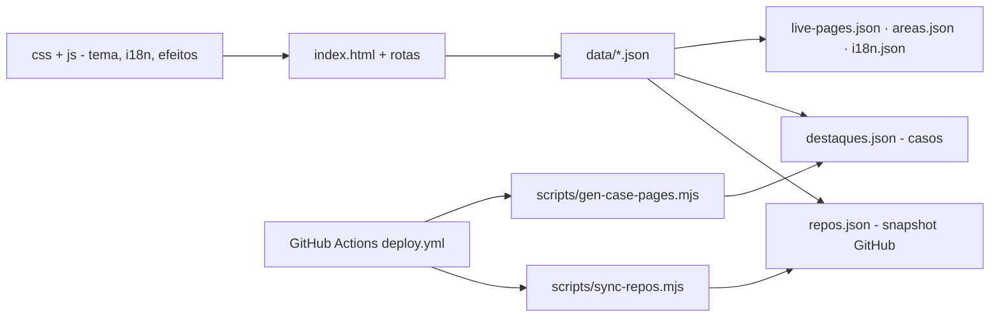

# portfolio-kelvin-v2

[English](README.en.md) · **Português (Brasil)**

[](#) [](#) [](#) [](#) [](#)

Portfólio multipágina de **Kelvin Oliveira** — HTML/CSS/JS puros, sem build, em português e inglês.

## O que é

Site de portfólio que apresenta os projetos, números e competências de Kelvin Oliveira. É um site estático multilíngue (PT/EN) que consome dados em JSON, navega por rotas e publica no GitHub Pages via GitHub Actions.

## Status

Em produção (versão v2). Publicado em <https://kelvinoliveiracode.github.io/portfolio/> (HTTP 200 verificado). Deploy automático via GitHub Actions.

## Funcionalidades

- **6 páginas**: Home, Projetos (arquivo completo), casos de estudo (`/projetos/<slug>/`), Sobre, Certificados e 404.
- **Explorador em árvore do GitHub** na home, com números rastreados a uma fonte.
- **Filtro por área e busca** na página de projetos.
- **11 casos de estudo** gerados por `scripts/gen-case-pages.mjs`.
- **4 certificados DIO** com link de verificação.
- **i18n PT/EN** (`data/i18n.json`).
- **Direção visual**: preto e branco sem acento cromático, planeta de Terra em pontos (canvas 2D) no hero, movimento opcional que respeita `prefers-reduced-motion`, contraste mínimo 4,5:1.

## Arquitetura

Site estático composto por `index.html` + CSS modular (`tokens.css`, `site.css`, `paginas.css`) + JS por página (home, efeitos, i18n, tree, et al.). Os dados vêm de `data/*.json`; um pipeline no deploy sincroniza os repositórios e regenera as páginas de caso.



## Stack

- HTML5, CSS3 (design tokens em `css/tokens.css`)
- JavaScript vanilla (rotas, i18n, efeitos, explorador)
- JSON (dados)
- Node (scripts de geração/sincronização)
- Deploy: GitHub Actions → GitHub Pages

## Estrutura do repositório

```
portfolio/
├── index.html · 404.html
├── css/                 # tokens, site, páginas, index
├── js/                  # home, efeitos, i18n, tree, strip, arquivo, planeta
├── data/
│   ├── repos.json       # snapshot público (103 repos)
│   ├── destaques.json   # textos dos casos de estudo
│   ├── live-pages.json  # páginas publicadas verificadas
│   ├── areas.json · i18n.json
├── certificados/        # página de certificados
├── scripts/             # servidor_local, sync-repos, gen-case-pages
└── .github/workflows/deploy.yml
```

## Pré-requisitos e instalação

Nenhum para servir. Para desenvolvimento, Python 3 ou Node.

## Desenvolvimento local

```bash
python scripts/servidor_local.py
# http://localhost:8791 (Cache-Control: no-store, sem cache velho de CSS/JS)

# ou, sem o script
python -m http.server 8080
# abra http://localhost:8080/index.html
```

## Deploy

GitHub Actions (`.github/workflows/deploy.yml`) publica em GitHub Pages sob `/portfolio/`; o pipeline sincroniza `repos.json`, regenera as páginas de caso e publica.

## Testes e qualidade

Não há suíte de testes automatizada (ausência de `package.json`/framework de teste confirmada). A qualidade é mantida por: dados com fonte rastreada (dado sem origem não entra), checagem dos números contra `repos.json`/certificados, e contraste mínimo 4,5:1 em todo texto.

## Decisões técnicas e trade-offs

- **Zero build/framework**: site leve, direto no GitHub Pages; o custo é gerenciar rotas e i18n à mão.
- **Dados em JSON com fonte rastreada**: cada número do site tem origem verificável; sincronização automática do snapshot de repositórios no deploy.
- **Design monocromático discreto com um único motivo (planeta)**: identidade forte sem ruído; movimento opcional por acessibilidade.

## Limitações conhecidas e roadmap

- Sem CMS: conteúdo novo exige editar os JSONs e rodar o gerador de casos.
- O snapshot `repos.json` é atualizado no deploy (se a chamada à GitHub API falhar, mantém o commitado).

## Processo de desenvolvimento

Projeto individual de Kelvin Oliveira, construído com agentes de IA orquestrados e revisado pelo autor. A arquitetura do site, o design system e a revisão são do autor.

## Licença e autor

Este repositório **não possui arquivo de licença** (sem `LICENSE`). Copyright (c) Kelvin Rebelo de Oliveira.

**Autor**: [Kelvin Oliveira](https://github.com/KelvinOliveiraCode)
